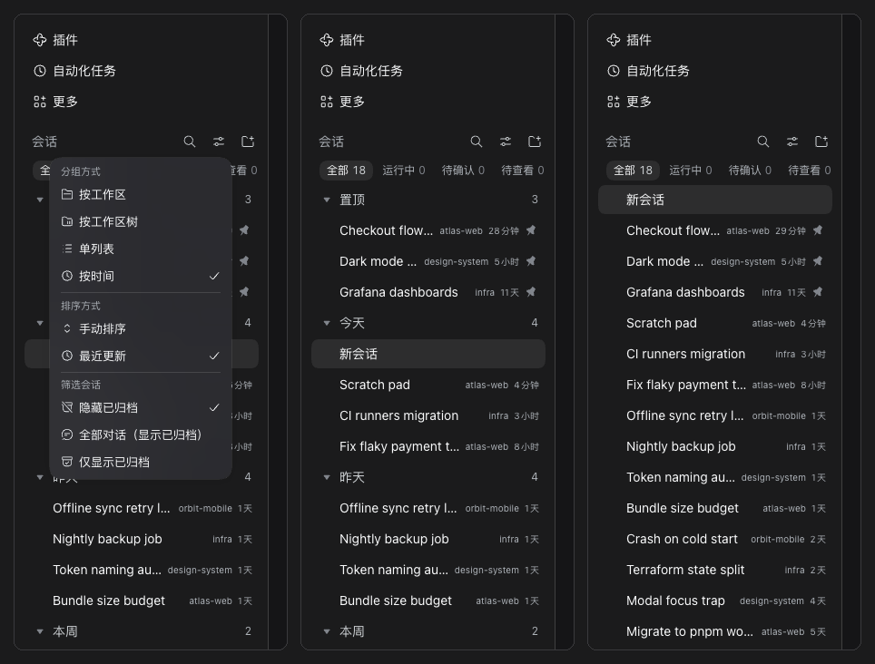

<p align="center">
  
</p>

# dsh-sidebar-view

[简体中文](README.md) | English

[](https://www.npmjs.com/package/dsh-sidebar-view)
[](LICENSE)
[](https://github.com/deepseek-ai)

**Two things the DeepSeek Harness session list does not have: grouping by time, and filtering by status.**

When five or six sessions are open and you come back the next day, the shipped sidebar only stacks them by workspace, so you scroll until you recognize "the one that touched CI yesterday". This plugin adds a fourth grouping mode, by time, and a row of status tabs with live counts — pinned, today, yesterday, this week, earlier — so you can see what is running and what finished while you were away.



*① The new “By time” entry in View options　② Pinned → Today → Yesterday → This week, each header with a count and collapse　③ One list across projects, optionally labelled with the workspace name*

## Features

- **Group by time**: a fourth entry in View options. Buckets are `Pinned → Today → Yesterday → This week (from Monday) → Earlier`; empty buckets disappear, and each header shows its count and collapses on click.
- **Flat across projects**: the time view ignores workspace boundaries, so sessions from every project share one timeline. Each row can end with its workspace name (`atlas-web`, `infra`, …) so you know where it came from without opening it.
- **Group by tag**: a fifth grouping mode that folds every session wearing the same tag together. Each tag header carries its colour dot and count, untagged sessions collect in a final "Untagged" group, and empty groups disappear.
- **Status tabs**: `All / Running / Awaiting / Unread` with live counts, sitting right under the section title. They apply to all five grouping modes (by workspace, workspace tree, one list, by time, by tag); groups and buckets that end up empty disappear.
- **Type scale and workspace names**: three sizes in View options (`Small 12 px / Default 14 px / Large 16 px`, the default matching the shipped title size). A size is a density, not just a glyph: rows follow at `24 / 28 / 32 px` and the gaps at `1 / 2 / 3 px`, and workspace rows, session rows, bucket headers, counts and timestamps all move together — the small size fits about three more rows per screen than the default. A "Show workspace names" toggle labels rows in the one-list and by-time views; the by-workspace views skip it because their headers already are the workspace.
- **Workspace icons**: right-click a workspace and pick "Workspace icon" — 166 emoji grouped by work / tech / nature / life, or switch to the icon face for 207 searchable line icons (`rock`, `folder`, `code`, …). Leave it unset and the folder icon stays; "Reset" restores it.
- **Tags**: right-click a session and pick "Tag" to choose one of nine hues (red / orange / amber / green / teal / blue / violet / pink / gray) and give it a name; the row then leads with a dot in that colour. Existing tags in the panel can be reused with one click. Every tag row carries a pencil and an ×: the pencil loads that tag into the editor (rename or recolour, then save, and every session wearing it follows); the × counts its references first and asks for confirmation ("Sessions using “X”: N. They will become untagged." — or "No session is using “X”." when the count is zero), and confirming removes the tag itself while its sessions fall back to untagged. "No tag" only clears the current session's binding and stays separate from deletion. A running session keeps its tag colour — the state moves to a ring around the dot (spinning while it runs), so the tag and the state no longer fight for the same 16 px slot.
- **Drag inside a bucket**: reorder rows in the time view, but only within the same bucket — dropping across buckets does nothing, because the bucket itself is decided by the last update time. The result is written back to the global manual order, so the one-list view reorders too.
- **Everything native still works**: search (local + host), context menus, rename, fork, pin, archive, manual sort, "show N more", add workspace, workspace menus, shortcuts, the collapsed 56 px rail — all delegated to the shipped implementation. The plugin only adds.

## What it solves

The shipped View options already covers by workspace, workspace tree, one list (flat), and hide-archived. What is missing is the time and status dimensions:

| Want | Shipped 0.2.2-rc.3 | This plugin |
| --- | --- | --- |
| Flat across projects | One list | Kept, plus an optional workspace name per row |
| Today / yesterday / this week | None | By time (fourth grouping mode) |
| All / running / awaiting / unread | None (archive filter only) | Status tabs with counts |
| Group by workspace | Yes | Kept |
| Pinned first | Yes | Kept, and its own bucket in the time view |

## Install

```bash
# From npm
dsh plugin --profile web add dsh-sidebar-view

# From GitHub (the repo ships the built client.js, no local build needed)
dsh plugin --profile web add git+https://github.com/GarinZ/dsh-sidebar-view.git

# Local development
dsh plugin --profile web add link:/path/to/dsh-sidebar-view
```

Restart the app to take effect. Uninstall:

```bash
dsh plugin --profile web remove dsh-sidebar-view
```

The plugin never patches shipped files and never writes user data; remove it and the sidebar is exactly the shipped one again.

> The desktop app runs the `desktop` profile (managed by Electron, so `--dump-config` is unavailable).
> To install there, replace `web` with `desktop` above, then quit and reopen the app.

## Compatibility

| Environment | Status |
| --- | --- |
| DeepSeek Harness `0.2.2-rc.3` · macOS desktop (`desktop` profile) | Verified |
| DeepSeek Harness `0.2.2-rc.3` · browser / `web` profile | Verified |
| Clean isolated profile with only this plugin | Verified: boots cleanly |
| DSH `0.3.x` | Untested; `engines.dsh` refuses the install, so you cannot land on a version that breaks |

The manifest declares `engines.dsh: >=0.2.2-0 <0.3.0`; the host checks it on install, update, and boot. To try a newer host early, opt in explicitly with `dsh plugin --profile <p> allow-version`.

## Usage

Open **View options** (the slider icon at the top right of the sidebar):

- pick **By time** under Grouping;
- click **All / Running / Awaiting / Unread** under the title to filter;
- click a bucket header to collapse it; drag rows to reorder inside a bucket.

Status meanings:

- **Running**: the session is working (including a running subagent);
- **Awaiting**: a tool call is waiting for your confirmation;
- **Unread**: the turn finished in the background and you have not opened it yet — this is the shipped `completionUnread` flag, and it resets on reload.

The incremental state lives in `localStorage["dsh.workspace.view.sidebar-view.v1"]`; the shipped
`dsh.workspace.view.v5` key stays owned by the shipped store. Delete both to reset.

## How it works: seated on the shipped component, not replacing it

The whole "sessions / workspaces" area is one component registered on the single
`sidebar.workspaces` slot. This plugin does **not** disable
`@deepseek-ai/dsh-client-ui-workspace` and does not register any service:

1. after the shipped plugin registers, wrap that entry's `component` in an error boundary;
2. the wrapper reads the shipped store snapshot, overlays two fields (`statusFilter`, bucket
   collapse state), and passes the shipped props (including `renderSlot`) to the ported browser component;
3. if the wrapper throws, the boundary renders the shipped component; if the bundle never loads,
   the shipped component was never touched.

Row decorations and row actions injected by other plugins keep working, and the worst case is
"the new features are missing", not "the client cannot boot".

## Limitations

- Relies on an undocumented internal contract of `0.2.2-rc.3` (`StoredEntry.component` is replaceable). If upstream changes it, the plugin goes inert instead of crashing.
- Drag only reorders inside a bucket: a bucket is decided by update time, so there is no valid cross-bucket target.
- The workspace chip takes about 72 px, so long titles truncate earlier than in the shipped UI.
- In a pure `web` profile the "add workspace" popover needs `dsh-client-ui-directory-picker-browse`; it works in the desktop app.

## Development

```bash
npm install
node build.mjs     # writes client.js (~220 KB, CSS inlined)
```

The build assembles the bundle in memory, smoke-tests it in `node:vm` (asserting that
`__ModuleLoader__.load` registers this package), then writes a temp file and `rename`s it into
place, so the host watcher can never read a half-written bundle.

The port lives in `src/browser/` (forked from the client sources of
`dsh-client-ui-workspace`); the incremental edits are commented in `src/browser/tree.ts`,
`stores.ts`, `locales.ts`, `rows/Rows.tsx` and `rows/WorkspaceBrowser.tsx`. On a DSH upgrade,
re-copy `src/browser/` from the new sources and re-apply those edits.

MIT License