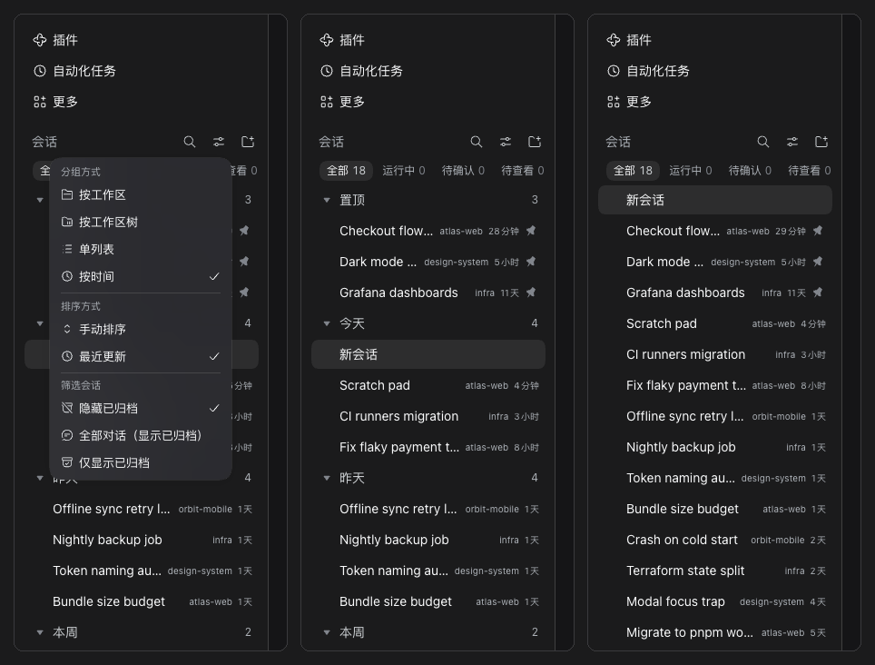

<p align="center">
  
</p>

# dsh-sidebar-view

简体中文 | [English](README.en.md)

[](https://www.npmjs.com/package/dsh-sidebar-view)
[](LICENSE)
[](https://github.com/deepseek-ai)

**给 DeepSeek Harness 的会话列表加两件原生没有的事：按时间分组，按状态筛选。**

同时开五六个会话、隔天再回来的时候，原生侧栏只按工作区堆着，你得自己一行行找回「昨天那个改 CI 的」。
这个插件给侧栏加一种「按时间」的分组方式，以及一排带计数的状态 Tab——置顶、今天、昨天、本周、更早，
一眼看到哪个在跑、哪个跑完了还没看。



*① 视图选项里多出的「按时间」　② 置顶 → 今天 → 昨天 → 本周，桶头带行数与折叠　③ 单列表跨项目平铺，可选在行尾标出工作区*

## 功能

- **按时间分组**：视图选项里多出第四种分组「按时间」。范围是 `置顶 → 今天 → 昨天 → 本周（周一起算）→ 更早`，空桶自动隐藏；桶头带行数与折叠三角，可以整段收起。
- **跨项目平铺**：时间视图不看工作区边界，所有项目的会话混在一条时间轴上，行尾可以标出所属工作区（`atlas-web`、`infra`……），不用点开就知道来自哪个项目。
- **按标签分组**：视图选项里多出第五种分组「按标签」，把打了同一个标签的会话收拢在一起，标签头带颜色点与行数，未打标签的会话收在最后的「无标签」组里，空组自动隐藏。
- **状态 Tab**：标题下面一排 `全部 / 运行中 / 待确认 / 待查看`，带实时计数。五种分组方式（按工作区 / 按工作区树 / 单列表 / 按时间 / 按标签）都生效，过滤后为空的组和桶自动消失。
- **字号与工作区名**：视图选项里能切三档字号 `小 12px / 标准 14px / 大 16px`（标准一档与 DSH 原生标题一致）。字号是一套密度，不只是一层字形：行高跟着走 `24 / 28 / 32px`、行间距 `1 / 2 / 3px`，工作区行、会话行、桶头、计数与时间戳同步缩放，小档一屏比标准多出三行左右。还有「显示工作区名称」开关，打开后单列表与按时间的行尾会标出归属，按工作区视图不加（表头本来就是工作区名）。
- **工作区前缀图标**：右键工作区选「工作区图标」，166 个 Emoji 按工作 / 技术 / 自然 / 生活分组平铺，也可以切到「图标」用 207 个线性图标并支持搜索（`rock`、`folder`、`code`……）。不设置就用原来的文件夹图标，对话框里随时「恢复默认」。
- **标签**：右键会话选「标签」，在行旁的小面板里挑九色之一（红 / 橙 / 琥珀 / 绿 / 青绿 / 蓝 / 紫 / 粉 / 灰）并给它起个名字，行首出现同色圆点；面板里已有标签可以点一下直接复用。每个标签行右侧有铅笔和 ×：铅笔把该标签载入编辑器（改名、换色后保存，所有复用它的会话一起变），× 先数一遍引用数再弹确认（「使用「X」的会话：N 个。删除后，这些会话会变成无标签。」；没人使用时写「没有会话在使用「X」。」），确认后标签实体消失、绑定会话变无标签。底部「无标签」只清除当前会话的绑定，与删除标签分开。运行中的会话保留标签色，状态改用套在外面的一圈状态环表示（跑动时是转圈），标签和状态不再抢同一个 16px 槽。
- **桶内拖拽**：时间视图里可以拖动排序，但只在同一个桶内生效——跨桶松手不会改序，因为桶本身由最后更新时间决定。落点写回全局手动顺序，单列表视图的顺序同步变化。
- **原生行为一个不少**：搜索（本地 + 宿主）、右键菜单、重命名、分叉、置顶、归档、手动排序、展开其余 N 个、添加工作区、工作区菜单、快捷键、收起 56px rail，全部沿用原生实现，插件只加不减。

## 它解决什么

原生的「视图选项」已经有三件事：按工作区、按工作区树、单列表（平铺），以及隐藏已归档。
缺的是时间维度和状态维度：

| 想要 | 原生 0.2.2-rc.3 | 本插件 |
| --- | --- | --- |
| 跨项目平铺 | 单列表 | 保留，且可选在行尾显示工作区名 |
| 今天 / 昨天 / 本周分组 | 无 | 按时间（第四种分组） |
| 全部 / 运行中 / 待确认 / 待查看 | 无（只有归档筛选） | 状态 Tab，带计数 |
| 按工作区分组 | 有 | 保留 |
| 置顶置前 | 有 | 保留，并在时间视图里单独成桶 |

## 安装

```bash
# 从 npm 安装
dsh plugin --profile web add dsh-sidebar-view

# 从 GitHub 安装（仓库里带了构建好的 client.js，无需本地构建）
dsh plugin --profile web add git+https://github.com/GarinZ/dsh-sidebar-view.git

# 本地开发
dsh plugin --profile web add link:/path/to/dsh-sidebar-view
```

装完重启应用生效。卸载：

```bash
dsh plugin --profile web remove dsh-sidebar-view
```

插件不改任何原生文件、不写用户数据；卸载后侧栏立刻回到原生样子。

> 真实桌面应用用的是 `desktop` profile（由 Electron 管理，不能 `--dump-config`）。
> 装进桌面版就把上面的 `web` 换成 `desktop`，装完退出应用再打开。

## 兼容性

| 环境 | 状态 |
| --- | --- |
| DeepSeek Harness `0.2.2-rc.3` · macOS Desktop（`desktop` profile） | 已验证 |
| DeepSeek Harness `0.2.2-rc.3` · 浏览器 / `web` profile | 已验证 |
| 隔离的干净 profile（只装本插件） | 已验证：启动无报错 |
| DSH `0.3.x` | 未验证；`engines.dsh` 会在安装时直接拒绝，不会让你装上一个会崩的版本 |

`package.json` 声明 `engines.dsh: >=0.2.2-0 <0.3.0`，宿主在安装、更新和启动时都会据此检查；需要提前试用时用 `dsh plugin --profile <p> allow-version` 显式豁免。

## 使用

打开侧栏右上角的**视图选项**（滑杆图标）：

- 「分组方式」里选 **按时间**；
- 想看某一个状态，点标题下方的 **全部 / 运行中 / 待确认 / 待查看**；
- 时间视图的桶头点一下可以收起整段；拖动行只在同一桶内换序；
- 外观：右键工作区设图标，右键会话设标签（颜色 + 名称），设置立刻生效并本地保存；想按标签看就在「分组方式 → 按标签」。

状态含义：

- **运行中**：会话正在跑（含正在跑子智能体）；
- **待确认**：有工具调用在等你的确认；
- **待查看**：这一轮在后台跑完、你还没打开过（沿用原生 `completionUnread`，刷新页面会清空）。

增量状态存在 `localStorage["dsh.workspace.view.sidebar-view.v1"]`，原生 key
`dsh.workspace.view.v5` 由原生 store 独占。想彻底重置，把这两个 key 一起删掉即可。

## 实现方式：坐在原生组件上，而不是接管它

侧栏「会话 / 工作区」整块是同一个组件，注册在 `sidebar.workspaces` 这个 single 槽位上。
本插件**不禁用** `@deepseek-ai/dsh-client-ui-workspace`，也不注册任何服务：

1. 等它注册完，把该条目的 `component` 包进自己的错误边界；
2. 外壳读原生 store 快照，叠加两个增量字段（`statusFilter`、时间桶折叠状态），
   再把原生 props（含 `renderSlot`）传给移植过的浏览器组件；
3. 组件抛错时，错误边界直接渲染原生组件；bundle 没加载时，原生组件根本没被动过。

所以第三方往行首/行尾注入的装饰、行操作按钮、目录选择器都照常工作，
最坏情况是「没有新功能」，而不是「客户端起不来」。

## 已知限制

- 依赖 `0.2.2-rc.3` 的未文档化内部契约（`StoredEntry.component` 可替换）。上游一旦改动，插件会「不生效」而不是崩溃。
- 时间视图的拖拽只作用于同一桶内：桶由更新时间决定，跨桶没有可写的目标位置。
- 行尾工作区 chip 占约 72px，长标题会比原生更早截断。
- 纯 `web` profile 下「添加工作区」的浮层需要 `dsh-client-ui-directory-picker-browse`，桌面应用里正常。

## 开发

```bash
npm install
node build.mjs     # 产出 client.js（约 220 KB，内含 CSS）
```

构建先在内存里拼产物，用 `node:vm` 跑一遍冒烟测试（断言 `__ModuleLoader__.load` 注册了本包），
再写临时文件并 `rename` 原子替换——避免宿主 watcher 读到写了一半的文件。

移植层在 `src/browser/`（fork 自 `dsh-client-ui-workspace` 的 client 源码），
增量改动的坐标写在 `src/browser/tree.ts`、`stores.ts`、`locales.ts`、`rows/Rows.tsx`、
`rows/WorkspaceBrowser.tsx` 的注释里。DSH 升级后按新版源码重新覆盖 `src/browser/` 再贴回增量。

MIT License